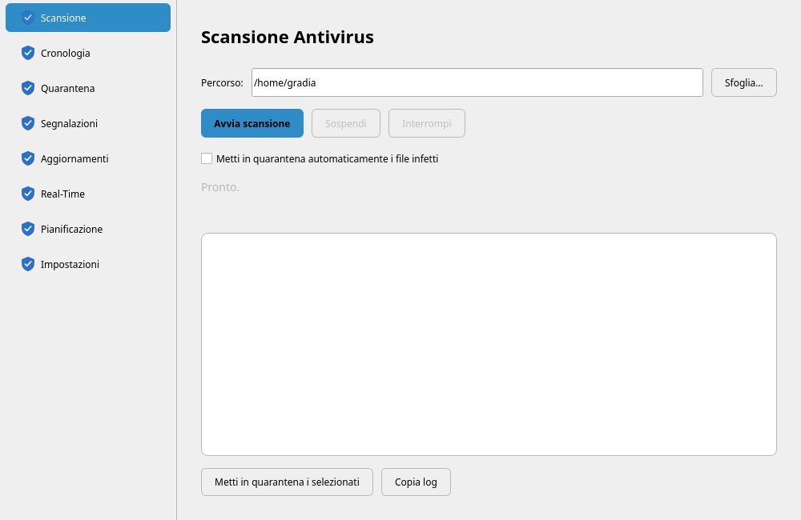
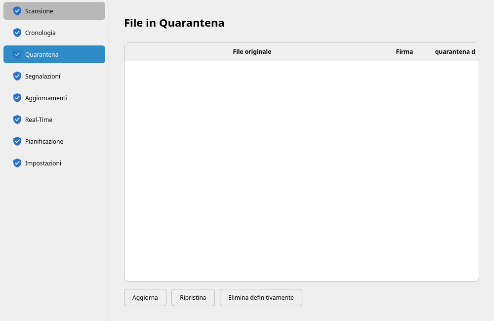
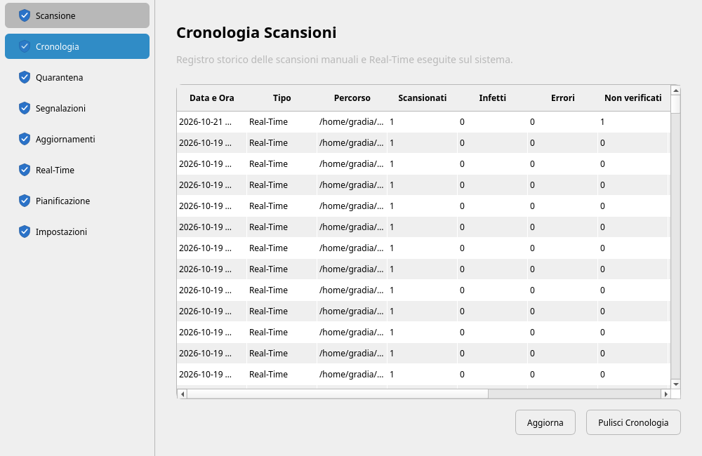
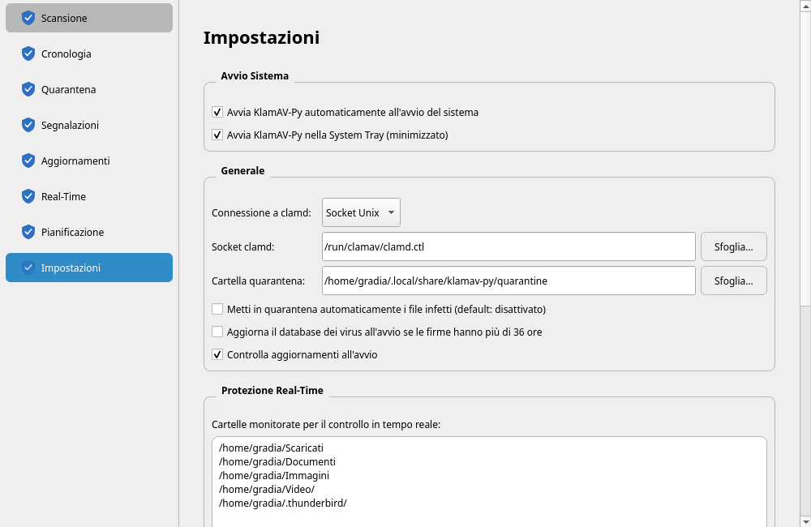

<p align="center">
  <a href="README.md"></a>
  <a href="README.en.md"></a>
  <a href="README.fr.md"></a>
  <a href="README.de.md"></a>
  <a href="README.es.md"></a>
</p>

# KlamAV-Py

**Lizenz:** GNU General Public License v3.0

Minimales Frontend für ClamAV via clamd — CLI und GUI für Linux.

Minimalistische Python-Neuimplementierung der Idee hinter KlamAV 0.22 (Frontend für ClamAV), ohne die Teile, die zu toter Technologie wurden (Dazuko, DCOP, Qt3), und ohne die Sicherheitsprobleme des Originals (Shell-Injection über KShellProcess): für die Scans werden keine externen ausführbaren Dateien aufgerufen, Pfade gelangen niemals über eine Shell.

<p align="center">
  
  
</p>
<p align="center">
  
  
</p>

## Merkmale

- Scanning über das native Protokoll von clamd (INSTREAM/IDSESSION über Unix-Socket), CLI und GUI.
- CLI ohne externe Abhängigkeiten (nur Standardbibliothek), GUI in PySide6.
- Quarantäne mit neutralisierten Berechtigungen (0400), nicht vorhersagbarer Name auf der Platte, Wiederherstellung der ursprünglichen Berechtigungen, gemeinsamer Index mit Lock-Schutz zwischen CLI/GUI/Worker.
- Geplante Scans: interner Timer der GUI und/oder systemd-User-Unit (über .deb-Paket), mit persistentem Log der Ergebnisse.
- Rekursives Real-Time-Monitoring der konfigurierten Ordner (QFileSystemWatcher, mit Erweiterung der Unterverzeichnisse, periodischer Reconcile verlorener Watches und konfigurierbarem Deckel, um fs.inotify.max_user_watches nicht zu erschöpfen).
- Pause/Fortsetzen von Scans, Guard „ein Scan zur Zeit".
- Größen-Vorprüfung: Dateien über StreamMaxLength werden als „nicht geprüft" gemeldet, ohne die clamd-Session zu verschwenden.
- Kenntnisnahme von Meldungen, die nicht verschoben wurden (heuristische Signaturen, Mailarchive): nach der Prüfung werden sie nicht mehr zu den Infizierten gezählt, solange der Inhalt nicht ändert.
- Integration ins Kontextmenü von Dolphin, Autostart, System Tray, Single-Instance mit IPC.
- Update-Kontrolle der Anwendung über GitHub Releases, manuell oder beim Start.

## Voraussetzungen

- clamav-daemon installiert und aktiv (clamd), nicht nur die Binaries clamscan/freshclam: dieses Projekt spricht mit dem Daemon über Socket, es ruft keine externen ausführbaren Dateien für die Scans auf.
- Python 3.10+ als deklarierte Baseline. Das technische Minimum ist real 3.9 (Path.is_relative_to); der Walrus-Operator in clamd_client.py existiert seit 3.8. Lokal getestet auf 3.14 (Debian Sid) und in CI auf 3.10–3.14.
- CLI: keine externe Laufzeitabhängigkeit — läuft auch mit dem System-Python, ohne venv.
- GUI: PySide6, in einem dedizierten venv zu installieren (siehe unten), nicht im System-Python.
- GUI, nur für die Aktualisierung der Virendatenbank über die Schaltfläche „Datenbank aktualisieren": freshclam im PATH und pkexec (PolicyKit) verfügbar, da die Operation Root-Rechte erfordert.
- GUI, nur für die Integration ins Kontextmenü von Dolphin: eine KDE-Plasma-Umgebung mit kbuildsycoca5/kbuildsycoca6.
- Entwicklung/Test: pytest (siehe requirements-dev.txt), zur Laufzeit nicht erforderlich.

## Installation

### Aus vorgefertigtem Release (empfohlen für den täglichen Gebrauch)

Lade das .deb-Paket von der Releases-Seite herunter und installiere es:

```bash
sudo dpkg -i klamav-py_*.deb
sudo apt-get install -f    # fehlende Abhängigkeiten beheben, falls nötig
```

Installiert klamav-py (CLI) und klamav-py-gui in /usr/bin/, aktiviert automatisch den systemd-User-Timer für den geplanten Scan und registriert die Anwendung in den Menüs. Details und Hinweise im Abschnitt „Paketierung .deb" weiter unten.

### Aus AUR (Arch Linux und Derivate)

```sh
git clone https://aur.archlinux.org/klamav-py.git
cd klamav-py && makepkg -si
```

Oder mit einem AUR-Helper: `yay -S klamav-py`, `paru -S klamav-py`.

Das Paket gilt auch für Manjaro, EndeavourOS, CachyOS und andere Derivate, die AUR nutzen. `pyside6` und `clamav` sind auf pacman-Ebene optionale Abhängigkeiten: die CLI funktioniert ohne GUI, aber für den normalen Gebrauch werden beide benötigt.

Im Gegensatz zum `.deb` wird der Timer für den geplanten Scan **nicht** während der Installation aktiviert: unter Arch entscheidet der Benutzer über den Systemzustand. Das Paket gibt die auszuführende Anweisung aus:

```sh
systemctl --user enable --now klamav-scan.timer
```

### Aus Quellen (Entwicklung oder Paket-Build)

**Build des .deb:**

```bash
sudo apt install devscripts debhelper dh-python pybuild-plugin-pyproject \
    python3-all python3-setuptools
cd klamav-py
dpkg-buildpackage -us -uc -b
sudo dpkg -i ../klamav-py_<version>_all.deb
```

**Entwicklungsumgebung (GUI aus Checkout):**

```bash
cd klamav-py
python3 -m venv venv
source venv/bin/activate
pip install -r requirements.txt
```

Mit Python 3.10 und 3.11 installiert `requirements.txt` PySide6 6.11.x: die Wheels ab 6.12 sind für Python 3.12 kompiliert und lassen die GUI nach wenigen hundert Signalen abstürzen (`Fatal Python error: bool_dealloc`; [PYSIDE-3474](https://qt-project.atlassian.net/browse/PYSIDE-3474)). In einem bereits bestehenden venv reicht es, `pip install -r requirements.txt` erneut auszuführen; zur Kontrolle: `python -c "import PySide6; print(PySide6.__version__)"` muss 6.11 oder älter ausgeben.

Mit aktivem venv (oder durch direkten Aufruf von venv/bin/python):

```bash
python3 -m klamav_py.gui.app
```

Die CLI braucht das venv nicht und läuft mit dem System-Python.

Hinweis für die Entwicklung: wenn im venv auch eine installierte Kopie des Pakets existiert (`pip install .` nicht-editable), kann der Import von klamav_py dort statt in der Checkout auflösen, je nach aktuellem Verzeichnis. Um der Falle zu entgehen, verwende `pip install -e .`; und auf einer Maschine mit Checkout und installiertem .deb prüfe immer, welche GUI-Instanz tatsächlich läuft (`ps aux | grep klamav`): durch Single-Instance wird der zweite Aufruf von der ersten bestehenden Instanz absorbiert, egal welche das ist.

## Schneller Einstieg

```bash
# CLI: prüfen, ob clamd antwortet (funktioniert auch ohne venv)
python3 -m klamav_py.cli ping

# CLI: Scan mit automatischer Quarantäne
python3 -m klamav_py.cli scan /home/benutzer/Downloads \
    --quarantine ~/.local/share/klamav-py/quarantine

# CLI: Scan des Home mit Ausschlüssen und Fehlerlog in Datei
python3 -m klamav_py.cli scan ~ \
    --exclude ~/.local/share/klamav-py \
    --exclude ~/.cache \
    --log-errors ~/klamav-errors.log

# GUI (erfordert aktives venv oder den venv-Interpreter, siehe oben)
python3 -m klamav_py.gui.app

# oder mit nicht-standard Socket/Quarantäne:
python3 -m klamav_py.gui.app --socket /run/clamav/clamd.ctl \
    --quarantine-dir ~/.local/share/klamav-py/quarantine

# oder um direkt den Scan eines Pfads zu starten (wird auch von der
# Dolphin-Integration genutzt, siehe unten):
python3 -m klamav_py.gui.app --scan-target /pfad/zum/scannen
```

Das an `--quarantine` übergebene Verzeichnis wird beim Durchlauf immer automatisch ausgeschlossen, sowohl in CLI als auch in GUI: bereits verwaltete Dateien dürfen nicht bei jedem Scan, der ihre Position abdeckt, erneut erkannt (und erneut quarantänisiert) werden.

## CLI: Scan-Optionen

- `--quarantine DIR` — verschiebt infizierte Dateien nach DIR (mit Berechtigungen 0700 erstellt).
- `--exclude DIR` — vom rekursiven Durchlauf auszuschließendes Verzeichnis (wiederholbar). Ausgeschlossene Verzeichnisse werden nicht einmal gelesen (Pruning): nützlich für Caches, Trash, synchronisierte Netzlaufwerke.
- `--max-stream-size BYTES` — Schwellenwert der Größen-Vorprüfung (Standard 25MB, angeglichen an StreamMaxLength in clamd.conf; 0 deaktiviert die Vorprüfung).
- `--log-errors FILE` — Detail zu jedem Fehler (Pfad und Grund) in Datei. Die Datei wird mit Berechtigungen 0600 erstellt; Symlinks, FIFOs und bereits existierende Dateien eines anderen Benutzers werden abgelehnt (Exit 2). Vermeide trotzdem gemeinsame Verzeichnisse wie /tmp: das Log listet Pfade deiner Dateien.
- `--version` — gibt die Version aus und beendet (globale Option, nicht des Unterkommandos scan).
- `--no-persistent` / `--session-batch-size N` — Steuerung der persistenten Session (siehe dedizierten Abschnitt).

Exit-Codes von `scan` — nützlich für OnFailure= in systemd oder für Monitoring-Skripte. Es gilt der erste zutreffende Fall, in dieser Reihenfolge:

| Reihenfolge | Exit | Fall |
| --- | --- | --- |
| 1 | 2 | Blockierender Fehler, der Scan startet nicht oder bricht ab: clamd unerreichbar; Pfad nicht vorhanden, defekter Link, weder Verzeichnis noch reguläre Datei, oder nicht lesbar; Quarantäne oder `--log-errors` nicht nutzbar |
| 2 | 1 | Mindestens eine Infektion gefunden, auch mit I/O-Ausfällen |
| 3 | 2 | Mindestens ein I/O-Ausfall ohne Infektionen (siehe unten) |
| 4 | 0 | Sonst |

Berechtigungsfehler, während des Scans verschwundene Dateien, zu große Dateien und Fehler von clamd auf einer einzelnen Datei ändern den Code nicht. Ein Unterverzeichnis mit Berechtigungsfehler ändert den Code nicht: es erscheint auf stderr als `CARTELLA NON LEGGIBILE` und hat einen eigenen Zähler in der Zusammenfassung; wenn es erwartet ist (mit sudo erstellte Verzeichnisse, Bind-Mounts von Containern), schließe es mit `--exclude` aus. Ein anderer Lesefehler, auf einer Datei oder einem Unterverzeichnis (EIO einer degradierenden Platte, ESTALE oder ETIMEDOUT eines nicht antwortenden NFS-Mounts), ist ein Ausfall: zählt zu den Fehlern und, ohne Infektionen, verlässt der Scan mit 2, weil ein Teil des Baums nicht kontrolliert wurde; die letzte Zeile der Zusammenfassung sagt das auch bei Exit 1. In der GUI ist das Ergebnis „Mit Fehlern abgeschlossen", und dieselbe Formulierung erscheint im Status und im Bericht des manuellen Scans, in der Benachrichtigung und im Log der internen Planung; die Historie hat eine Spalte „I/O-Ausfälle".

## Meldungen, die nicht verschoben werden, und Kenntnisnahme

Heuristische Signaturen (`Heuristics.*`) und Dateien in Mailarchiven werden nur gemeldet, nie automatisch verschoben: ein Nachricht verschieben zerstört das Archiv des Mailclients. Eine solche Meldung wiederholte sich jedoch bei jedem Scan, und mit dem System-Timer kam jede Nacht dieselbe Benachrichtigung, bis man aufhörte hinzusehen.

Nach der Prüfung der Datei lösche sie oder registriere die Kenntnisnahme:

```bash
journalctl --user -u klamav-scan.service | grep INFETTO
klamav-py --acknowledge ~/.local/share/local-mail/trash/new/1695.R42.host
klamav-py --list-acknowledged        # Präfix des Hash, Signatur, Pfad, Daten
klamav-py --unacknowledge 3f2a9c01be47   # nach Hash-Präfix oder nach Pfad
```

`--acknowledge` scannt die Datei mit clamd neu und registriert die Kenntnisnahme nur, wenn sie noch mit einem „nur Meldung"-Treffer infiziert ist. Die Regel ist die der Scans, also muss es mit denselben `--report-only` (und `--quarantine-all`) aufgerufen werden, die im Scan verwendet wurden, vorangestellt: `klamav-py --report-only ~/Archiv --acknowledge ~/Archiv/alt.exe`. Folgende Scans drucken `GIÀ VALUTATO` und zählen sie nicht zu den Infizierten: ein **neuer** Treffer ergibt weiterhin 1 und benachrichtigt. Der Schlüssel ist der SHA-256 des Inhalts plus die Signatur, nicht der Pfad: eine Nachricht, die von `new/` nach `cur/` wandert, bleibt bewertet, geänderter Inhalt wird wieder gemeldet, und eine Kenntnisnahme versteckt niemals einen Treffer, der in Quarantäne müsste. Die Kenntnisnahme gilt also für Inhalt und Signatur, in beliebigem Pfad: eine identische Kopie an anderer Stelle mit derselben Signatur gilt als bereits bewertet. Einträge, die 90 Tage lang von keinem Scan gefunden werden, werden entfernt. Register in `~/.local/share/klamav-py/acknowledged.json` (0600), geteilt mit der GUI, wo die Seite **Meldungen** dieselben Aktionen bietet (und das Löschen, nur wenn die Datei noch die gemeldete ist; für ein von Akonadi verwaltetes Maildir kann danach `akonadictl fsck` nötig sein). Die Seite zeigt auch die Meldungen des System-Timers und der CLI: jeder Scan schreibt sie sofort nach dem Fund in `~/.local/share/klamav-py/pending-reports.json` (0600), sie bleiben also auch bei einem abgebrochenen Scan erhalten, und zwar bis du die Datei löschst, die Kenntnisnahme registrierst oder die Datei nicht mehr existiert.

## Persistente Session, Größen-Vorprüfung, Rekonstruktion

Standardmäßig verwendet `scan_stream` eine einzelne Verbindung (IDSESSION-Session) für mehrere Dateien in Folge statt für jede eine neue zu öffnen — auf Bäumen mit Zehntausenden von Dateien vermeidet das den Overhead wiederholter connect. Die Session wird trotzdem alle 500 Dateien (`--session-batch-size`) geschlossen und neu geöffnet, um die Auswirkung nicht dokumentierter Grenzen bei sehr langen Sessions zu begrenzen, und von Grund auf neu erstellt, sobald etwas schiefgeht: eine problematische Datei gefährdet nicht den Rest des Scans.

Wenn clamd die Verbindung schließt (typischer Fall: Ablehnung wegen StreamMaxLength), wird die Session als tot markiert und vor der nächsten Datei neu erstellt, so dass die folgenden Dateien nicht kaskadenartig auf einer bereits geschlossenen Verbindung sterben.

Größen-Vorprüfung: Dateien über der Schwelle (Standard 25MB, wie StreamMaxLength) werden gar nicht an clamd gesendet — sie verlassen sofort mit Status TOO_LARGE („nicht geprüft"), unterschieden von echten Fehlern sowohl in CLI als auch in GUI. Ohne Vorprüfung lehnt clamd den Stream zur Hälfte des Sendens ab und schließt die Verbindung: der Fehler, den der Benutzer sehen würde, wäre eine „unterbrochene Pipe" bei einer Datei, die in Wirklichkeit in Ordnung ist (siehe „Diagnose häufiger Fehler").

Die Vorprüfung hat eine bekannte und akzeptierte Race — eine Datei, die zwischen Prüfung und Senden über die Schwelle wächst, wird trotzdem vom Fallback behandelt, der Stream-Fehler bei Dateien über der Schwelle als TOO_LARGE klassifiziert.

Nicht-reguläre Einträge (seit 0.1.5): Symlinks, Sockets, FIFOs und Devices werden beim Durchlauf verworfen und nicht an clamd gesendet.

`os.walk()` klassifiziert alles, was keine Verzeichnis ist, als „Datei", so dass sie in der zu scannenden Liste landeten, mit zwei Folgen: hängende Symlinks (häufig in node_modules und in bereinigten pnpm-Stores) erzeugten Hunderte von falschen ERRORE „[Errno 2] Datei oder Verzeichnis nicht vorhanden", und `open()` auf eine FIFO ohne Schreiber BLOCKIERT unbegrenzt im Kernel — keine Ausnahme, kein Timeout: eine einzige FIFO im Baum hängte den gesamten Scan auf.

Das sind keine Abdeckungslücken: ein Symlink hat keinen eigenen Inhalt (das Ziel, wenn es im Baum liegt, wird als reale Datei gescannt), und Sockets, FIFOs und Devices haben keinen persistenten infizierbaren Inhalt. Daher erscheinen sie nicht in den Ergebnissen und gehen nicht in die Invariante `scanned = clean + infected + errors + too_large` ein; sie werden separat gezählt und in der CLI-Zusammenfassung angezeigt. TOO_LARGE und Berechtigungsfehler bleiben dagegen sichtbar, weil sie echte Lücken sind.

Das Öffnen verwendet `O_NOFOLLOW|O_NONBLOCK` mit `fstat()`-Prüfung auf dem bereits geöffneten Deskriptor: die Typkontrolle betrifft genau das Objekt, das gelesen wird, ohne TOCTOU-Fenster gegenüber dem Pfad.

Timeout (seit 0.1.5): das Warten auf das Urteil von clamd hat ein eigenes Timeout (120s), getrennt von dem für Verbindung und Senden (30s). Das sind verschiedene Dinge: die Bytes zu senden ist schnell, aber die Analyse eines Archivs oder eines PDFs mit vielen verschachtelten Objekten kann viel länger dauern. Mit einem einzigen niedrigen Wert ergaben solche Dateien „Session clamd unterbrochen: timed out", obwohl sie perfekt lesbar waren.

Timeouts berechtigen zu einem zweiten Versuch auf sauberer Session (nur bei Timeouts: bei unterbrochener Pipe würde es sich um eine Ablehnung wegen StreamMaxLength handeln und ein erneuter Versuch wäre Verschwendung); eine Datei, die auch beim zweiten Versuch nicht geprüft wird, hat eine eigene Meldung, weil das eine echte Abdeckungslücke ist. Der Wert muss mit CommandReadTimeout/ReadTimeout in clamd.conf kohärent gehalten werden: wenn clamd vorher aufgibt, nützt es nichts, das Timeout clientseitig zu verlängern.

Wenn du vermutest, dass ein Problem mit der persistenten Session zusammenhängt, bringt `--no-persistent` das Verhalten „eine Verbindung pro Datei" zurück, um den Fall zu isolieren.

Am Ende des Scans druckt die CLI eine Zusammenfassung der Fehler gruppiert nach Typ (z. B. „2 Permission denied", „1 Broken pipe"), statt manuell grep/sort/uniq -c machen zu müssen.

## GUI: Übersicht der Oberfläche

PySide6-Anwendung mit einem Fenster, Seitenleiste und Stil inspiriert von KDE Plasma (verwendet immer die Farben der Systempalette, nie hartkodierte Farben, außer für semantische Zustände wie „infiziert"). Acht Abschnitte:

- **Scan** — manueller Scan auf einem frei wählbaren Pfad, in einem separaten QThread (ScanWorker): das Fenster bleibt auch bei großen Verzeichnissen reaktionsfähig, und die Statusleiste zeigt die Datei in Bearbeitung in Echtzeit (mit Textelision, damit das Layout bei langen Pfaden nicht wächst). Die Zähler unterscheiden gescannt / infiziert / Fehler / nicht geprüft (zu groß), und nur Infizierte/Fehler/nicht-geprüfte erzeugen Zeilen in der Liste.
- **Suspendieren / Fortsetzen.** Die Pause hat Granularität einer ganzen Datei: die im Streaming befindliche Datei wird abgeschlossen, dann hält der Worker an (die Schaltfläche folgt den Signalen des Workers, nicht dem Klick, daher ist der angezeigte Zustand immer der tatsächliche). „Abbrechen" bleibt auch in der Pause aktiv. Nach einer Pause länger als ~25s (nahe am IdleTimeout von clamd, standardmäßig 30s) wird die Session beim Fortsetzen proaktiv neu erstellt, um einen falschen Fehler auf der ersten Datei zu vermeiden. Mit dem Fenster minimiert in der Tray zeigt das Tooltip des Symbols die Zähler des laufenden Scans und den Pausenzustand.
- **Manuelle Quarantäne standardmäßig.** Das Kästchen „Infizierte Dateien automatisch in Quarantäne verschieben" ist standardmäßig deaktiviert: die gemeldeten Dateien bleiben, wo sie sind, und du verschiebst sie mit „Ausgewählte in Quarantäne verschieben" — praktisch, um ein Falschpositiv zu bewerten, bevor etwas verschoben wird. „Log kopieren" kopiert alle Zeilen der Liste (Infizierte, Fehler, nicht geprüfte) in die Zwischenablage.
- **Historie** — persistentes Register (~/.local/share/klamav-py/history.json, letzte 1000 Einträge; das Verzeichnis ist 0700 und die Dateien 0600, weil sie Pfade und infizierte Dateien auflisten) mit Datum/Uhrzeit, Typ, Pfad, gescannt, infiziert, Fehler, nicht geprüft, nicht lesbare Verzeichnisse, bereits bewertet und I/O-Ausfälle (eine Teilmenge der Fehler), plus dem Grund für einen nicht abgeschlossenen oder verschobenen Scan. Geplante Scans indizieren auch das detaillierte Log auf Platte (Tooltip auf der Zeile): das Detail zu Infizierten/Fehlern eines Hintergrund-Scans, der keine UI-Liste durchläuft, bleibt so immer einsehbar.
- **Quarantäne** — liest denselben JSON-Index, den die CLI verwendet (index.json im Quarantäneverzeichnis): die beiden Werkzeuge sind auf denselben Daten austauschbar. Wiederherstellung am ursprünglichen Ort (mit Wiederherstellung der ursprünglichen Berechtigungen, explizite Ablehnung, wenn der Pfad inzwischen belegt wurde) oder endgültiges Löschen.
- **Meldungen** — die erkannten, aber an Ort und Stelle belassenen Dateien (heuristische Signaturen, Mailarchive) der Scans der Sitzung, mit „Ich habe geprüft, nicht mehr melden" (Kenntnisnahme, siehe „Meldungen, die nicht verschoben werden, und Kenntnisnahme") und „Löschen…" mit Bestätigung; darunter die registrierten Kenntnisnahmen, widerrufbar.
- **Aktualisierungen** — lädt die Virendefinitionen herunter, indem `freshclam --stdout` über pkexec gestartet wird (PolicyKit-Authentifizierung), wobei der Systemdienst clamav-freshclam/freshclam gestoppt wird, um Lock-Konflikte auf der Logdatei zu vermeiden, und am Ende neu gestartet wird. Seit 0.1.7 erfolgt der Neustart auch, wenn das Update unterbrochen wird (Logout, Signal), und betrifft nur die Dienste, die vorher aktiv waren: ein absichtlich gestoppter Daemon bleibt gestoppt. Ausgabe in Echtzeit. Bei der Wahl von „Beenden" während des Updates schließt sich die App, sobald es endet, statt es abzubrechen. Startet standardmäßig 1.5s nach dem App-Start (in Einstellungen deaktivierbar).
- **Real-Time** — Log der automatischen Scans auf den überwachten Ordnern (konfigurierbar in Einstellungen). Nutzt QFileSystemWatcher: Erstellung/Änderung einer Datei → Scan nach einem Debounce von 3s (um noch geschriebene Dateien nicht zu scannen), und infizierte Dateien werden immer automatisch in Quarantäne verschoben. Zu große Dateien werden als „Nicht geprüft" etikettiert, nicht als „Sicher" (siehe Designentscheidungen).
- **Planung** — wiederkehrender Scan (alle N Stunden oder Tage) auf einem frei wählbaren Ordner, über internen QTimer: erfordert die laufende App (auch minimiert in der Tray). Während der Ausführung zeigt die Seite den Status und die Live-Zähler; das Tray-Tooltip spiegelt den Fortschritt; am Ende des Scans wird das detaillierte Log in ~/.local/share/klamav-py/logs/scheduled-<timestamp>.log geschrieben (Rotation: letzte 10 Ausführungen) und in der Historie referenziert. Es ist kein System-Timer wie der des .deb-Pakets, der auch bei geschlossener GUI läuft (siehe „Geplante Scans: die beiden Mechanismen").
- **Einstellungen** — Socket von clamd, Quarantäneverzeichnis, vom Real-Time überwachte Ordner (mit Indikator „Real-Time aktiv auf N Ordnern (M Unterverzeichnisse eingeschlossen, rekursiv)"), Autostart beim Login, minimiert in der Tray starten, DB-Update beim Start, Update-Kontrolle der Anwendung (Schaltfläche und Option beim Start), Dolphin-Integration.

## Real-Time-Monitoring: wie es funktioniert (0.1.5)

QFileSystemWatcher ist nicht rekursiv: er beobachtet genau die Ordner, die ihm übergeben werden. Bis 0.1.4 bedeutete das, dass Dateien, die in den UNTERVERZEICHNISSEN eines überwachten Ordners erstellt wurden, kein Event erzeugten — die Oberfläche erklärte den Real-Time aktiv auf einem Ordner, blieb aber auf alles darunter blind.

Seit 0.1.5 werden die konfigurierten Ordner rekursiv expandiert (Symlinks nicht gefolgt, versteckte Ordner übersprungen, weil es meist Caches sind, die kontinuierlich Events erzeugen). Drei Pfade halten die Abdeckung aktuell:

- Unterverzeichnisse, die nach dem Start erstellt werden: sofort beim Empfang des Events auf dem enthaltenden Ordner angehängt;
- in den Baum verschobene oder aus einem Archiv extrahierte Bäume: mv erzeugt ein einziges Event auf der obersten Ebene, daher werden die bereits gefüllten Unterverzeichnisse durch die periodische Reconcile wiederhergestellt (bis zu 60s Latenz);
- verlorene Watches (gelöschter und neu erstellter Ordner): dieselbe Reconcile.

Dateien, die in einem Ordner vorhanden sind, der NACH dem Start entdeckt wird, werden analysiert, nicht baselined: das ist das Szenario des Archivs, das anderswo extrahiert und dann hineinverschoben wird, in dem der Inhalt sonst nie gescannt würde. Beim Start der Anwendung ist das Verhalten entgegengesetzt und gewollt: die bereits vorhandenen Dateien werden zum Referenzzustand ohne Scan, sonst würde bei jedem Neustart der gesamte überwachte Ordner neu gescannt.

Jeder beobachtete Ordner verbraucht einen inotify-Watch, und fs.inotify.max_user_watches wird mit ALLEN Prozessen des Benutzers geteilt (IDE, Cloud-Synchronisierer, Indizierer). Darum gibt es einen Deckel (MAX_WATCH_DIRS, Standard 8000): prüfe dein Limit mit `cat /proc/sys/fs/inotify/max_user_watches` und passe es entsprechend an.

Sowohl das Erreichen des Deckels als auch die addPaths()-Fehler werden im Statusindikator explizit gemeldet — ein Real-Time, der sich aktiv erklärt, während er auf der Hälfte der Ordner blind ist, ist schlechter als ein abgeschalteter.

Die Programmversion ist im Fenstertitel, im Ruhe-Tooltip der System Tray und im Einstellungspanel sichtbar.

Alle Einstellungen werden mit QSettings gespeichert (Organisation „KlamAV-Py", Anwendung „KlamAV-Py" — unter Linux typischerweise ~/.config/KlamAV-Py/KlamAV-Py.conf). Einstellungen von Versionen vor 0.1.3-2 (Datei ~/.config/KlamAV/KlamAV.conf) werden beim ersten Start automatisch migriert; die alte Datei bleibt auf der Platte.

## Intentionale Designentscheidungen

Manuelle Quarantäne beim Scan, automatisch beim Real-Time. Das ist keine Inkonsistenz: die beim Real-Time überwachten Ordner sind typischerweise Ziele frisch heruntergeladener/empfangener Dateien von außen (z. B. ~/Downloads) — das Risiko eines Falschpositivs bei einer neuen, nie angefassten Datei ist gering, daher sinnvoll, sofort zu handeln. Die Seite Scan kann auf Ordner mit wichtigen Daten zeigen, wo ein Falschpositiv vor dem Verschieben geprüft werden soll.

Guard „ein Scan zur Zeit" zwischen manuell und geplant. Ein manueller Scan startet nicht, wenn ein geplanter läuft (und umgekehrt überspringt der geplante, mit explizitem Eintrag in der Historie und Benachrichtigung, wenn ein manueller aktiv ist). Gründe: Konkurrenz um clamd (zwei home-weite Traversierungen parallel verdoppeln I/O und Speicher des Daemons) und doppelte Belastung des Dateisystems. Real-Time ist absichtlich vom Guard ausgenommen: es ist der primäre Schutz, wirkt auf einzelne Dateien (Sekunden), und clamd handhabt gleichzeitige Verbindungen per Design — es auszusetzen, während ein manueller läuft, wäre schlimmer. Ein pausierter Scan gilt als „laufend" im Sinne des Guards: er blockiert den geplanten, bis er fortgesetzt oder abgebrochen wird.

Ausschluss des Quarantäneverzeichnisses. Dateien in Quarantäne sind die von der Anwendung verwalteten Daten: sie werden beim Durchlauf ausgeschlossen (Pruning, nicht einmal gelesen) und, als Tiefenverteidigung, lehnt quarantine_file() explizit ab, eine Datei, die bereits innerhalb des Quarantäneverzeichnisses liegt, erneut zu quarantänisieren. Ohne diese Guards würde ein home-weiter Scan bei jedem Zyklus die alten EICARs in Quarantäne neu erkennen und infizierte Dateien sowie Fehler für immer mit bereits verwalteten „Geistern" aufblähen.

## System Tray und Single-Instance

Die App bleibt in der System Tray aktiv, auch wenn das Fenster geschlossen wird (das X blendet sie aus, beendet sie nicht: beendet wird über das Tray-Menü oder „Beenden"). Sie ist für den Hintergrundbetrieb für Planung und Real-Time gedacht. Beim Beenden werden laufende Threads (Scans, Ping an clamd, Update-Kontrolle) gestoppt und bis zu 3 Sekunden gewartet; solche, die über diesem Limit auf I/O blockiert sind, verhindern die Beendigung nicht.

Außerdem Single-Instance: startest du die GUI, während eine andere Instanz bereits aktiv ist, sendet die zweite ihren `--scan-target` (falls vorhanden) an die erste und beendet sich sofort, statt ein zweites Fenster zu öffnen. Das ist der Mechanismus, der die Dolphin-Integration sinnvoll macht: beim Klick auf „Mit KlamAV-Py scannen" auf mehreren Dateien/Ordnern landen alle Anfragen im selben bereits geöffneten Fenster.

Der IPC-Socket liegt in der Runtime-Verzeichnis des Benutzers (`$XDG_RUNTIME_DIR/klamav-py-ipc`, typischerweise `/run/user/<uid>/`), nicht in `/tmp`, und bevor irgendwelche Daten gesendet werden, verifiziert die zweite Instanz mit `SO_PEERCRED`, dass der lauschende Prozess demselben Benutzer gehört. Wenn keine sichere Runtime-Verzeichnis existiert oder der IPC-Server nicht starten kann, läuft die GUI trotzdem ohne Single-Instance und meldet das: ein zweiter Start würde eine weitere Kopie öffnen.

Beim Update von 0.1.6 oder älter verwendet eine noch offene alte Instanz den alten Socket und wird von der neuen nicht erkannt: schließe sie aus der Tray, bevor du die Anwendung neu startest.

## Dolphin-Integration

Über das Einstellungspanel kann der Eintrag „Mit KlamAV-Py scannen" im Kontextmenü von Dolphin installiert werden, indem eine .desktop-Datei in ~/.local/share/kservices5/ServiceMenus/ und ~/.local/share/kio/servicemenus/ geschrieben und der KDE-Service-Cache neu generiert wird (kbuildsycoca5/6). Das `Exec=` ruft den Befehl direkt ohne zwischengeschaltete Shell auf: ein Dateiname mit `, ` oder $ kann das Quoting nicht brechen.

## Autostart

Wenn aktiviert, schreibt er eine .desktop-Datei in ~/.config/autostart/, die die GUI mit dem aktuell verwendeten Python-Interpreter startet; wenn deaktiviert, entfernt er die Datei.

## Update-Kontrolle der Anwendung

Die Schaltfläche „Auf Updates prüfen" in Einstellungen fragt die GitHub-Releases-API des Projekts ab und vergleicht die letzte veröffentlichte Version mit der verwendeten. Die Option „Beim Start auf Updates prüfen" ist standardmäßig deaktiviert: ohne sie kontaktiert die Anwendung GitHub nicht, außer auf ausdrückliche Anfrage. Wenn eine neue Version vorhanden ist, erscheint ein Link zur Release-Seite (und eine Benachrichtigung in der Tray für die Prüfung beim Start); die Installation bleibt manuell, über .deb oder AUR.

Die Prüfung beim Start läuft höchstens einmal alle sechs Stunden: die unauthentifizierte GitHub-API gewährt 60 Anfragen pro Stunde pro IP-Adresse, und häufiges Neustarten der Anwendung soll diese nicht verbrauchen. Die Schaltfläche in Einstellungen unterliegt nicht dem Limit.

Die GitHub-Antwort wird als nicht vertrauenswürdige Daten behandelt: sie wird bis maximal 256 KB gelesen, Version und Notizen werden vor der Anzeige escaped, und der Link wird nur klickbar gemacht, wenn er auf die Releases des offiziellen Repositories zeigt.

## Geplante Scans: die beiden Mechanismen

- **GUI-Timer (Seite Planung):** läuft nur mit aktiver App (auch in der Tray), bietet aber Live-Fortschritt, persistentes Log und vollständige UI-Integration.
- **systemd-User-Unit (installiert vom .deb und vom Arch-Paket):** startet beim Login jedes Benutzers ohne Konfiguration, läuft bei geschlossener GUI. Um den Timer auch bei abgemeldetem Benutzer laufen zu lassen:
  `loginctl enable-linger $USER`. Verwendet denselben Standard-Quarantänepfad der GUI (~/.local/share/klamav-py/quarantine). Fehler und nicht lesbare Verzeichnisse des letzten Scans, eine pro Zeile, stehen auch in `~/.local/state/log/klamav-py/scan-errors.log` (`$XDG_STATE_HOME/log/klamav-py`, das `LogsDirectory=` der Unit), zusätzlich zum Journal.
  Quarantäne, Verbindung zu clamd und in der GUI gewählte ausgeschlossene Ordner gelangen per Drop-in, `~/.config/systemd/user/klamav-scan.service.d/50-klamav-py.conf`, zum Timer, erkannt an der ersten Zeile `# Generato da KlamAV-Py: non modificare a mano.`. Sie werden von den Speicherungen in Einstellungen und Planung geschrieben; beim Start schreibt die GUI auch ein eigenes Drop-in, das bei einer früheren Version hängen geblieben ist (zum Beispiel ohne `--log-errors`), und sagt das auf der Seite Planung. Eine Datei mit diesem Namen ohne diese erste Zeile, also handgeschrieben, wird nie angefasst. Den Befehl, den der Timer verwenden wird, siehst du mit: `systemctl --user cat klamav-scan.service`.

Eine Systemd-Unit auf Systemebene wird nicht mehr verteilt (seit 0.1.9): sie konnte private Homes nicht lesen, ohne deren Berechtigungen zu lockern, während die User-Unit als der Benutzer selbst läuft und seine Home unverändert liest.

## Diagnose häufiger Fehler

Bei einem home-weiten Scan einer echten Entwicklermaschine (330k+ Dateien) sind die verbleibenden Fehler physiologisch und erkennbar:

- **„Unterbrochene Pipe" bei großen Dateien** — clamd hat den Stream wegen StreamMaxLength (Standard 25MB in clamd.conf) abgelehnt und die Verbindung zur Hälfte des Sendens geschlossen. Mit aktiver Größen-Vorprüfung ist das fast verschwunden: Dateien über der Schwelle verlassen als „nicht geprüft", ohne die Session zu berühren. Um das Limit zu erhöhen:
  `StreamMaxLength 100M` in clamd.conf und Neustart von clamd — mit dem Trade-off, dass ein höheres Limit es einfacher macht, clamd mit riesigen Streams zu verstopfen.

  Ehrlichkeitsnotiz: auch Dateien innerhalb des Stream-Limits bleiben MaxScanSize/MaxFileSize/MaxRecursion von clamd unterworfen (ungefähre Standards 100M/25M/16): ein umfangreiches Archiv kann „OK" mit teilweiser Scan ergeben — Grenze von clamd selbst, nicht von diesem Projekt erkennbar.

- **Errno 13 „Zugriff verweigert"** — echte Dateisystem-Berechtigungen (z. B. von Docker-Containern in der Home gehaltene Dateien). Ist kein Problem des Projekts.

- **Errno 2 „Datei oder Verzeichnis nicht vorhanden"** — seit 0.1.5 sollte das selten sein. Bis 0.1.4 war die dominante Ursache NICHT die hier dokumentierte (Dateien während der Traversierung verschwunden): es waren hängende Symlinks, die os.walk() als Dateien klassifiziert und die open() nicht öffnen kann. Auf Bäumen mit node_modules oder bereinigten pnpm-Stores waren das Hunderte von Zeilen, die echte Fehler verdeckten. Jetzt werden Symlinks vorgelagert verworfen. Was bleibt, ist die ursprünglich vermutete Ursache — Dateien, die wirklich zwischen Traversierung und Lesen verschwunden sind (geleerter Trash, Cloud-Sync, Browser, der den Cache neu schreibt) — und in dieser Form erwartetes Rauschen.

- **Errno 6 „Gerät oder Adresse nicht vorhanden"** — AF_UNIX-Sockets (GPG-Agent, MEGAsync, Native-Messaging-Hosts der Browser). Wie oben: seit 0.1.5 vorgelagert verworfen, sollten nicht mehr auftreten.

- **„timed out"** — auch hier war die Erklärung bis 0.1.4 unvollständig. Nicht nur Latenz von Netzlaufwerken: das einheitliche 30s-Timeout deckte sowohl das Senden als auch das WARTEN auf das Urteil ab, und clamd kann bei Archiven oder PDFs mit vielen verschachtelten Objekten viel länger brauchen. Perfekt lesbare lokale Dateien ergaben reproduzierbar „Session clamd unterbrochen: timed out". Seit 0.1.5 hat das Warten ein eigenes Timeout (120s) und Timeouts haben einen zweiten Versuch. Wenn du noch welche siehst, prüfe CommandReadTimeout/ReadTimeout in clamd.conf, bevor du das Dateisystem verdächtigst.

- **Fehler in Massen eines einzelnen Typs (Tausende)** — fast sicher clamd tot oder mitten im Scan neu gestartet:
  `journalctl -u clamav-daemon.service` im Zeitraum des Scans, und `dmesg | grep -i oom` für den OOM-Fall. Die CLI-Zusammenfassung nach Typ (oder das persistente Log der Planung) macht diesen Fall sofort vom physiologischen Rauschen unterscheidbar.

## Sicherheits-Fixes in 0.1.8

- **Anwendungsdaten für andere lokale Benutzer lesbar.** Historie, Logs der geplanten Scans und Fehlerlogs der CLI wurden mit den Standardberechtigungen des umask erstellt (Verzeichnis 0755, Dateien 0644): sie listen gescannte Pfade, Signaturnamen und infizierte Dateien auf. Auf einem System mit Home 0755 — historischer Standard, noch häufig auf aktualisierten Installationen — waren sie für einen anderen lokalen Benutzer lesbar. Jetzt ist das Datenverzeichnis 0700 (bei Start eingeschränkt, daher werden auch Dateien älterer Versionen unzugänglich) und die Dateien 0600. Das `--log-errors`-Log war der schlimmste Fall, weil das README dessen Einsatz in /tmp vorschlug, wo ein anderer Benutzer es vorab erstellen konnte, um den Inhalt zu lesen.
- **Konfigurationsdatei mit 0644.** `~/.config/KlamAV-Py/KlamAV-Py.conf` listet die vom Real-Time überwachten Ordner sowie Scan- und Quarantänepfade auf, wurde aber von Qt geschrieben und entging so der Behandlung der anderen Daten. Sie wird beim Start auf 0600 gesetzt, zusammen mit der Legacy-Konfigurationsdatei der 0.1.3, falls noch vorhanden.
- **Antworten von clamd ohne Obergrenze.** Antworten wurden im Speicher angesammelt, bis der Socket sie lieferte: ein entfernter clamd über TCP oder ein Socket in einem benutzerkonfigurierbaren Pfad konnte den RAM erschöpfen. Das Lesen stoppt jetzt bei 1 MiB. Betrifft nicht den System-clamd, der root gehört.

## Sicherheits-Fixes in 0.1.7

- **Umgehung der Quarantäne über Hardlink + Symlink.** Die Prüfung der Inode-Identität nach dem Verschieben (eingeführt in 0.1.4, siehe unten) verwendete `os.stat()`, das Symlinks folgt. Eine infizierte Datei konnte einen Hardlink anderswo erstellen und ihren eigenen Pfad durch einen Symlink auf diesen Hardlink ersetzen: das Verschieben brachte nur den Link in Quarantäne, `os.stat()` fand die ursprüngliche Inode wieder und die Prüfung bestand. Der infizierte Inhalt blieb draußen und ausführbar, der Index registrierte eine erfolgreiche Quarantäne und „Endgültig löschen" entfernte nur den Link. Die Prüfung verwendet jetzt `os.lstat()` und die Berechtigungen werden mit `fchmod()` auf dem bereits verifizierten Deskriptor angewendet. Erfordert ein gewonnenes Race eines Prozesses desselben Benutzers, ist aber in Schleife wiederholbar.
- **IPC-Socket der Single-Instance in /tmp.** Bis 0.1.6 lag der Socket unter `/tmp/klamav_py_ipc`, in einem Verzeichnis, das allen Benutzern gehört. `UserAccessOption` verhinderte, dass andere sich mit dem Socket der Anwendung verbinden, verhinderte aber nicht, dass die Anwendung sich mit dem Socket eines anderen verbindet: ein zweiter lokaler Benutzer konnte den Namen zuerst belegen, die in den Scan gesendeten Pfade empfangen und, indem er auf die Verbindung antwortete, jedem Start glauben lassen, dass eine Instanz bereits aktiv sei, und so den Start der GUI völlig verhindern (kein Real-Time, keine geplanten Scans). Jetzt liegt der Socket in der Runtime-Verzeichnis des Benutzers, der Client verifiziert den Peer mit `SO_PEERCRED` und das Fehlschlagen von `listen()` wird gemeldet. Auf einem Desktop mit einem einzigen Benutzer nicht ausnutzbar.

## Sicherheits-Fixes in 0.1.4

Diese Version löst eine Reihe von Sicherheitsproblemen, die aus einem Code-Audit hervorgingen. Das Referenz-Bedrohungsmodell ist ein Multi-User-System und, für die Quarantäne, die infizierte Datei selbst als potenziell feindlicher Inhalt (nicht ein externer Angreifer).

- **TOCTOU in Quarantäne und Wiederherstellung.** `quarantine_file()` öffnet die Datei mit O_NOFOLLOW und prüft die Inode-Identität (dev+ino) nach dem Verschieben, statt einem separaten is_file()-Check vor der Move-Operation zu vertrauen: eine infizierte Datei könnte versuchen, das Isolation durch Austausch mit einem Symlink in dem Fenster zwischen Prüfung und Verschieben zu umgehen. Symlinks (und spezielle Dateien wie FIFOs) werden jetzt explizit abgelehnt. `restore()` beansprucht das Ziel atomar mit O_CREAT|O_EXCL statt exists() gefolgt von move(), wodurch das Fenster entfällt, in dem ein anderer Prozess die Zieldatei in der Mitte erstellen könnte.
- **IPC-Socket der Single-Instance eingeschränkt und validiert.** Der QLocalServer verwendet UserAccessOption: ohne ihn hängen die Socket-Berechtigungen unter Linux vom umask des Prozesses ab und könnten für andere Benutzer des Systems zugänglich sein. Der vom Socket empfangene Pfad ist jetzt in der Größe begrenzt (vermeidet riesige Payloads als DoS) und robust dekodiert (ein fehlerhaftes UTF-8-Payload wird ignoriert, nicht als Ausnahme weitergegeben). Seit 0.1.7 liegt der Socket nicht mehr in `/tmp`: siehe vorherigen Abschnitt.
- **Datenbank-Update an den Systemdienst delegiert.** Die Schaltfläche „Datenbank aktualisieren" führt nur `pkexec /usr/bin/systemctl restart clamav-freshclam.service` aus, mit festem argv und verifizierten root-owned Binaries: freshclam lädt die Signaturen als Benutzer `clamav`, mit dem Sandboxing der Distributionseinheit, statt als root zu laufen. Das Ergebnis wird anhand der von clamd gemeldeten DB-Version geprüft; beim Start startet das Update nur, wenn die Signaturen älter als 36 Stunden sind.
- **Neugenerierung des KDE-Service-Caches ohne Shell.** `os.system()` wurde durch `subprocess.run()` mit explizitem argv ersetzt (keine Shell).
- **Berechtigungen der .desktop-Dateien der Dolphin-Integration von 0755 auf 0644 gebracht.**

  **ACHTUNG** — diese Änderung war FALSCH und wurde in 0.1.5 zurückgenommen. Die Begründung (die .desktop sind Konfigurationsdateien, die freedesktop-Spezifikation will kein Ausführungsbit) gilt für Launcher in /usr/share/applications, NICHT für KIO-Servicemenüs: ab KFrameworks 5.85 müssen diese ausführbar sein, und mit 0644 antwortet Dolphin „Du bist nicht berechtigt, diese Datei auszuführen" und der Menüeintrag funktioniert nicht mehr. Die beiden Ziele haben entgegengesetzte Anforderungen: der Launcher bleibt 0644, das Servicemenu kehrt zu 0755 zurück. Hier dokumentiert, weil die Begründung für sich gelesen korrekt wirkt und genau so kann die Regression wieder eingeführt werden.

Die Fixes sind durch 9 neue automatische Tests abgedeckt (Ablehnung von Symlinks und FIFOs in der Quarantäne, Prüfung des atomaren Anspruchs des Ziels bei der Wiederherstellung, Validierung des IPC-Payloads).

## Hinweis zu 0.1.4-2 (Korrektheit, nicht Sicherheit)

Die Wurzel jedes Scans wird jetzt zu Beginn von `scan_stream` aufgelöst (`Path.resolve()`), an einem einzigen Punkt gemeinsam für alle Arten, einen Scan zu starten (CLI, GUI manuell, Dolphin/IPC-Integration, und in Zukunft Real-Time und geplant). Das ist kein Sicherheits-Fix: im Fall von IPC ist der Socket bereits auf denselben Benutzer beschränkt, also gibt es keine Privilegien-Grenze zu schützen und ein Symlink gibt keinen Zugriff auf etwas, das der Benutzer nicht bereits lesen könnte. Es ist ein Korrektheits-Fix: wenn der zu scannende Pfad ein Symlink-Verzeichnis ist, folgt `os.walk()` ihm trotzdem, wenn er der Ausgangspunkt ist (`followlinks=False` blockiert nur Symlinks innerhalb des Baums, nicht die Wurzel), und ohne Auflösung würde der Scan-Bericht die Ergebnisse unter dem Pfad des Symlinks statt unter dem tatsächlich gelesenen realen Pfad anzeigen. Für einen Antivirus zählt der tatsächlich kontrollierte Inhalt, nicht der Alias, über den man dorthin gelangte.

Die Auflösung erfolgt einmalig auf der Wurzel, nicht für jede Datei: `_iter_files` (die eigentliche Traversierung) bleibt unverändert, so dass sowohl das Streaming mit konstantem Speicher als auch das Pruning ausgeschlossener Verzeichnisse (Quarantäne eingeschlossen) weiterhin exakt wie zuvor funktionieren. Symlinks innerhalb des Baums werden weiterhin nicht gefolgt.

## Was im Vergleich zum ursprünglichen KlamAV fehlt (absichtlich)

- **Kein kernel-level on-access scanning.** Das Real-Time-Monitoring basiert auf QFileSystemWatcher (rekursiv seit 0.1.5, mit einigen Sekunden Latenz und einem Deckel für die Anzahl beobachteter Ordner) — es ist kein Ersatz für einen echten on-access-Scanner. Dafür bietet ClamAV bereits clamonacc (fanotify-basiert): es hat keinen Sinn, ein Äquivalent zu Dazuko neu zu implementieren. Wenn echtes on-access nötig ist, wird es über clamd.conf/clamav-clamonacc.service konfiguriert.
- **Keine clientseitige Mail-Integration.** Wenn Mail-Scanning nötig ist, macht heute serverseitig (milter) mehr Sinn als clientseitig KMail/Evolution wie klammail.

## Entwicklung und Tests

```bash
cd klamav-py
python3 -m venv venv        # falls noch nicht erstellt
source venv/bin/activate
pip install -r requirements-dev.txt
python3 -m pytest tests/
```

Die Tests decken die reine Logik ohne echten clamd ab (Parsing des clamd-Protokolls, Quarantäne-Verwaltung auf temporärem Dateisystem, CLI) und die GUI mit Offscreen-Instanziierung der Seiten und Simulation von Signalen/Aktionen (Wiederaufnahme Scan↔Quarantäne, Status-Elision, Zwischenablage, Pause/Fortsetzen mit eingefügtem Fake-Client über client_factory).

Auf Distributionen mit „externally managed" Python (neuere Debian/Ubuntu, PEP 668) schlägt `pip install -r requirements-dev.txt` außerhalb eines venv mit externally-managed-environment fehl: erwartetes Verhalten des Systems, verwende das venv.

## Lizenz

KlamAV-Py wird unter der Lizenz GPL-3.0-or-later veröffentlicht (siehe Datei LICENSE). Code von Grund auf neu geschrieben: enthält keinen Code aus KlamAV 0.22, von dem es nur ein spiritueller Erbe der Idee ist.

## Paketierung .deb

Das Debian-Gerüst liegt in debian/, getestet mit realem Build (dpkg-buildpackage) und vollständiger Installation/Entfernung (dpkg -i / apt-get remove --purge).

Vor der Installation prüfen: das Gerüst wurde in einer Ubuntu-24.04-Umgebung validiert, wo python3-pyside6.qtcore und Verwandte in den Repositories nicht existieren (Ubuntu paketiert nur PySide2). Unter Debian sollten sie existieren, aber vor der Installation des .deb prüfe mit `apt-cache search pyside6`, ob die in debian/control aufgeführten Pakete (python3-pyside6.qtcore, .qtgui, .qtwidgets, .qtnetwork) in deiner Version existieren, und korrigiere die Namen, falls sie abweichen.

### Was das Debian-Gerüst macht

- Ein einziges Binärpaket klamav-py mit CLI und GUI (kein Split, solange das Projekt jung ist).
- `pyproject.toml` definiert zwei Entry Points in /usr/bin/: klamav-py (CLI) und klamav-py-gui (GUI). Die GUI nutzt sie, um den Befehl für die .desktop-Dateien von Autostart und Dolphin automatisch zu erkennen (`_gui_relaunch_command()`), statt eine lokale Checkout mit venv anzunehmen.
- Das Feld license verwendet absichtlich das alte Tabellenformat (`{text = "..."}`) statt der SPDX-Zeichenkette: neuere setuptools deprecaten das erste mit einer Warnung, aber ältere setuptools (verifiziert: 68.1.2, Ubuntu 24.04) lehnen das zweite mit einem fatalen Fehler ab. Besser eine kosmetische Warnung überall als ein kaputter Build auf einigen Systemen.
- systemd-Units auf BENUTZEREBENE (systemd --user), nicht Systemebene (warum, siehe unten). Die Dateien heißen `debian/klamav-py.klamav-scan.user.service/.timer`: das Segment `.user.` im Namen ist obligatorisch, damit dh_installsystemduser sie erkennt — erst durch empirisches Testen eines realen Builds entdeckt. Sie landen in /usr/lib/systemd/user/.
- postinst/postrm verwenden deb-systemd-helper --user: der Aktivierungssymlink landet in /etc/systemd/user/timers.target.wants/ (gilt für alle Benutzer) und der Timer startet beim nächsten Login jedes Benutzers, ohne manuelle Befehle.
- Eine User-Unit kann sich nicht zuverlässig gegenüber einer System-Unit wie clamav-daemon.service anordnen (separate systemd-Manager, keine cross-manager-Abhängigkeiten): das .service hat kein After=/Requires= auf clamd. In der Praxis kein Problem: clamd startet lange vor dem Benutzer-Login.

## Warum User-Units statt System-Units

Die allererste Version verwendete eine System-Unit mit DynamicUser=yes. Schien sauber (kein manuelles useradd), hielt aber realem Gebrauch nicht stand:

- Homes werden mit 0700/0750 geboren: ein dynamischer Benutzer liest nichts, und der Scan von /home produzierte nur Permission denied in Massen.
- Die Quarantäne landete in /var/lib/klamav-py, im Besitz des dynamischen Benutzers: die GUI konnte sie weder sehen noch verwalten.

Die User-Unit läuft als der Benutzer, liest die Home ohne Probleme und verwendet dieselbe Standard-Quarantäne wie die GUI: die Pfade stimmen überein.

### Upgrade von älteren Versionen (die die System-Unit hatten)

Das Entfernen der alten Unit-Datei stoppt keine bereits laufende Instanz — der Symlink in /etc/systemd/system/timers.target.wants/ wird von dpkg nicht verfolgt. Deshalb enthält postinst eine dedizierte Migration, die die alte System-Unit explizit stoppt und deaktiviert, bevor die neue User-Unit aktiviert wird (verifiziert durch Lesen des postinst des kompilierten .deb).

## Paketierung Arch (AUR)

Das PKGBUILD liegt in `arch/`, zusammen mit dem Skript `klamav-py.install` und `test-local.sh`.

Das `source` zeigt auf den GitHub-Release-Tag. Achtung auf ein asymmetrisches Detail: die Tags des Projekts haben das Präfix `v` (`v0.1.6`), das Verzeichnis im Archiv aber nicht (`KlamAV-Py-0.1.6`), daher das `v$pkgver` in der URL und das `$pkgver` in den `cd` von `build()` und `package()`. Die heruntergeladene Datei wird in `$pkgname-$pkgver.tar.gz` umbenannt, um in `SRCDEST` nicht mit Archiven anderer Pakete zu kollidieren.

`pkgver` muss bei jedem Release zusammen mit `klamav_py/__init__.py`, `debian/changelog` und `CHANGELOG.md` aktualisiert werden; `tests/test_changelog.py` prüft die Ausrichtung und dass die von `package()` installierten Dateien wirklich existieren. `sha256sums` muss bei jedem neuen Tag neu generiert werden, mit `updpkgsums` auf einer Arch-Maschine oder von Hand.

`arch/test-local.sh` erlaubt, das Paket in einem Arch-Container ohne Arch-Maschine zu validieren:

```sh
arch/test-local.sh --tag      # Build vom GitHub-Tag, PKGBUILD unverändert
arch/test-local.sh            # Build vom aktuellen Arbeitsbaum
KLAMAV_TEST_GUI=1 arch/test-local.sh   # prüft auch den GUI-Start
```

Die `--tag`-Variante ist die vor der Veröffentlichung auf AUR zu verwendende: sie ist die einzige, die URL und Checksumme wirklich prüft, weil die anderen aus einem lokalen Tarball bauen und das PKGBUILD on the fly patchen.

## Vor einer stabilen Release zu prüfen

- **Version:** `klamav_py/__init__.py` ist die Quelle der Wahrheit. Seit 0.1.5 leitet pyproject.toml sie aus `klamav_py.__version__` ab (`[tool.setuptools.dynamic]`) statt sie neu zu deklarieren. Manuell abzugleichen bleiben `debian/changelog` (mit `dch`) und `CHANGELOG.md`, aber die Konsistenz wird von `tests/test_cli.py` und `tests/test_changelog.py` geprüft, die auch in CI laufen. Das Missalignment war nicht theoretisch, auf zwei verschiedene Arten: die Version in pyproject.toml blieb bei 0.1.4 stehen, während die anderen Quellen schon bei 0.1.5 waren, und `CHANGELOG.md` blieb drei Releases lang bei 0.1.3 stehen, weil kein Schritt des Release-Prozesses es anfasste.
- **Changelog:** `CHANGELOG.md` ist die benutzerorientierte Chronologie, distributionsunabhängig; `debian/changelog` enthält die Metadaten des Debian-Pakets; `docs/CHANGELOG-archive.md` bewahrt das ausführliche Detail bis 0.1.3 und die Audit-Runden. Nach `dch` erzeugt `tools/changelog-stub.sh` den Entwurf des neuen Eintrags in `CHANGELOG.md` aus dem eben in `debian/changelog` geschriebenen, von Hand zu kürzen.
- Kein automatischer Test prüft die Installation des .deb als solche (manuelle Prüfung): wenn das Projekt wächst, lohnt ein CI-Job mit sbuild/pbuilder, der es von Grund auf neu baut.

## Natürliche Erweiterungen

- **Circuit Breaker auf den Ergebnissen:** wenn clamd mitten im Scan stirbt, erzeugt jede verbleibende Datei einen Fehler „Session clamd konnte nicht geöffnet werden" (Mechanismus hinter einem beobachteten Vorfall mit ~10.200 Fehlern). Ein Zähler aufeinanderfolgender Fehler über einer Schwelle würde den Scan mit einem schnellen, lesbaren Fehlschlag statt dem Flood abbrechen.
- **Über die UI konfigurierbare Ausschlüsse** (heute nur über `--exclude` CLI): Caches, Trash, Netzlaufwerke — würde das Rauschen weiter reduzieren und home-weite Scans beschleunigen.
- **Unterschiedlicher Name des QLocalServer pro sys.prefix:** auf einer Entwicklermaschine mit Checkout+venv und installiertem .deb würden installierte und Checkout-Instanz nicht um dieselbe Single-Instance konkurrieren.
- **Native Desktop-Benachrichtigungen** (notify-send oder direktes D-Bus) zusätzlich zu QSystemTrayIcon.showMessage, für Desktops mit irregulärem Tray-Support.
- **Export des Quarantäne-Indexes** in ein von einem Web/TUI-Frontend lesbares Format (z. B. um die Quarantäne vom NAS aus zu kontrollieren).
- **Über die UI konfigurierbar**, ob Real-Time automatisch in Quarantäne verschieben oder nur melden soll.

## Verifikation der Releases

Seit 0.1.10 sind die Release-Tags mit dem Projektschlüssel signiert:

    gradia (KlamAV-Py release signing) <gradia@disroot.org>
    Impronta: EBEE 3E80 EFA3 8B42 B147  F1B9 9D7A A4F1 971F EAA9

```bash
gpg --keyserver hkps://keys.openpgp.org --recv-keys EBEE3E80EFA38B42B147F1B99D7AA4F1971FEAA9
# oder, wenn keys.openpgp.org nicht antwortet oder den Schlüssel nicht liefert:
gpg --keyserver hkps://keyserver.ubuntu.com --recv-keys EBEE3E80EFA38B42B147F1B99D7AA4F1971FEAA9
git clone https://github.com/gradia64/KlamAV-Py.git && cd KlamAV-Py
git tag -v v0.1.10
```

Ohne Keyserver liegt der öffentliche Schlüssel auch im Repository:

```bash
gpg --import arch/klamav-py-release-key.asc
gpg --fingerprint EBEE3E80EFA38B42B147F1B99D7AA4F1971FEAA9
```

In jedem Fall prüfe, dass der von `gpg` angegebene Fingerabdruck mit dem
oben angegebenen übereinstimmt: der Keyserver (oder die Datei im Repository)
garantiert nur, eine Schlüssel zu liefern, nicht dass es der richtige ist.
Gib den Keyserver immer mit `--keyserver` an: ohne verwendet `gpg` den
konfigurierten, der den Schlüssel möglicherweise nicht hat. Tags vor 0.1.10
sind nicht signiert.

Seit 0.1.15 haben auch die an die Release angehängten Dateien (`.deb`,
Arch-Paket, Quelle) eine abgetrennte Signatur `.sig`, plus ein signiertes
`SHA256SUMS`. Mit dem importierten Schlüssel wie oben:

```bash
gpg --verify SHA256SUMS.sig SHA256SUMS
sha256sum --check --ignore-missing SHA256SUMS
gpg --verify klamav-py_0.1.15-1_all.deb.sig klamav-py_0.1.15-1_all.deb
```

Die Anhänge werden von der CI mit einem dedizierten Unterschlüssel
signiert, `F9F4 2835 8660 2F8D D724  C467 0888 61B0 4D8D 328D`; die
Tags signiert der Maintainer mit `FDC2 2208 6F32 BADB 0403  4BAF 707F 1CD9 C887 FD2E`.
`gpg` ordnet beide der oben angegebenen Primärschlüssel zu. Wenn `gpg`
die Signatur eines Anhangs nicht erkennt, ist deine Kopie des Schlüssels
älter als der CI-Unterschlüssel: lade sie wie oben vom Keyserver oder aus
dem Repository neu herunter.
", "path">
/home/gradia/Progetti/klamav-py/README.de.md